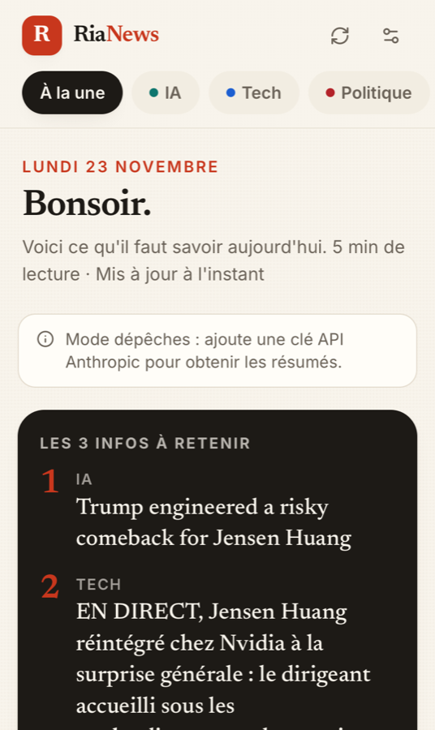
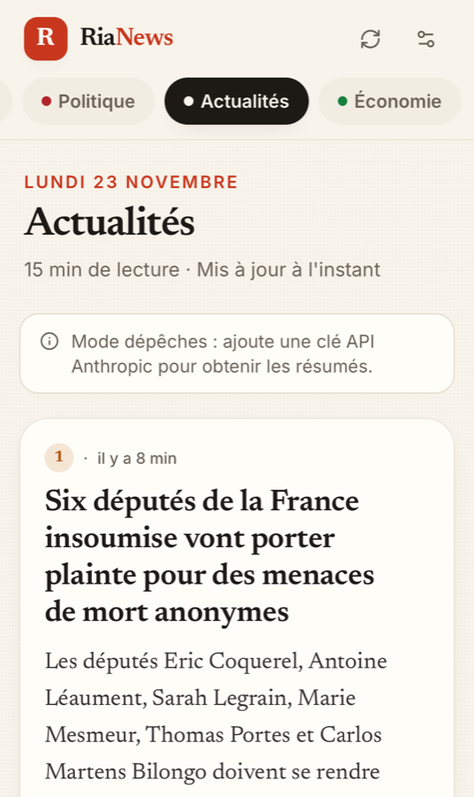
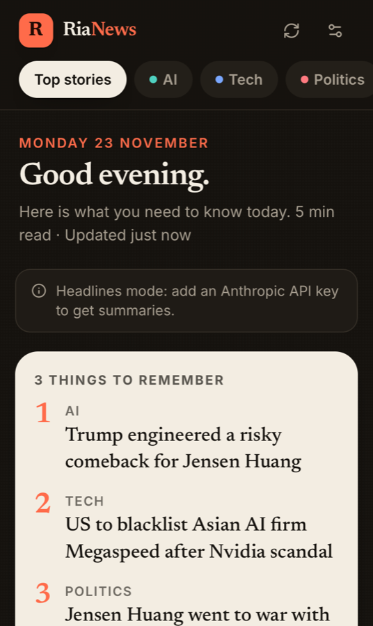
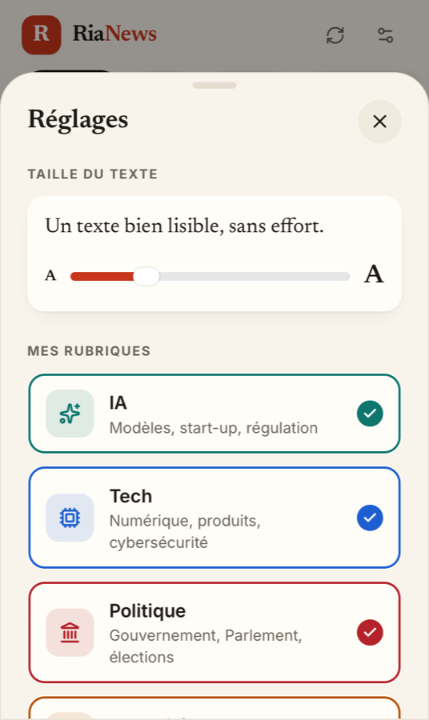
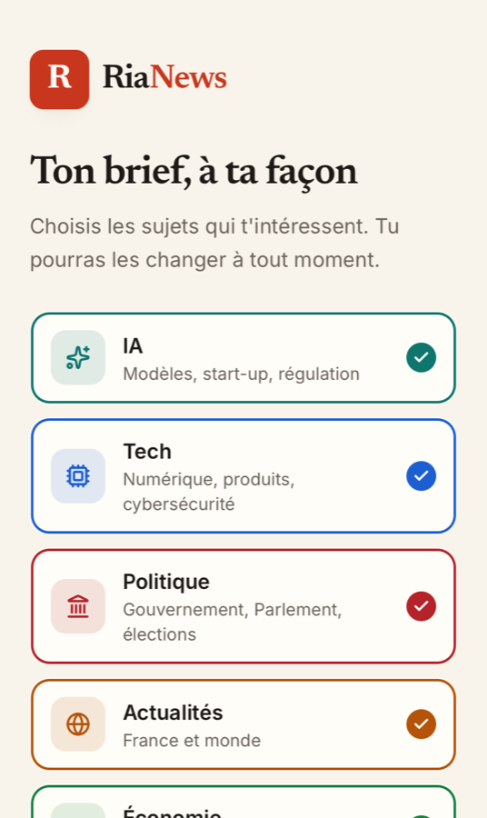
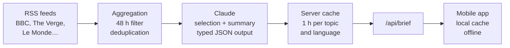

<div align="center">


# RiaNews

**The news that matters, in two minutes.**

An installable mobile app (iPhone and Android) that sums up the day's essential news by topic: AI, tech, politics, world news, economy. Short format, large type, built to be read with one hand.

[](https://nextjs.org)
[](https://www.typescriptlang.org)
[](https://tailwindcss.com)
[](https://docs.claude.com)
[](https://web.dev/progressive-web-apps/)
[](https://rianews.vercel.app)
[](./LICENSE)

[**Open the app**](https://rianews.vercel.app) · [Lire en français](./README.md)

</div>

---

## Why RiaNews?

You want to know what's going on and be able to talk about it over dinner or at the coffee machine, without spending an hour scrolling through news feeds. RiaNews reads twenty-odd outlets for you, keeps the stories that really matter and sums them up in a few lines:

- **what happened**, in two sentences, with the key figures and names;
- **why it matters**, in one sentence;
- **a conversation starter**: a striking figure, some perspective, a little-known bit of context.

Two minutes of reading in the morning, and you know what counts.

## Preview

<div align="center">

| Home | Section | Dark mode (EN) | Settings | First launch |
| :---: | :---: | :---: | :---: | :---: |
|  |  |  |  |  |

</div>

## Features

| | |
| --- | --- |
| 📰 **One brief per topic** | The 6 most important stories of the last 48 hours, deduplicated across outlets and ranked by importance. |
| ⚡ **Short format** | Clear headline, the gist in 2 sentences, "Why it matters", "Conversation starter". |
| 🥇 **3 things to remember** | At the top of the home page, the lead story of your first three topics. |
| 🎯 **Pick your topics** | AI, Tech, Politics, News, Economy: chosen on first launch, editable at any time. |
| 🔠 **Reading comfort** | 5 text sizes (17 to 26 px), Newsreader serif typography, light, dark or automatic theme. |
| 📲 **Installable** | PWA: home screen icon, full screen, no app store needed. |
| ✈️ **Offline** | The last brief stays readable without a connection (service worker + `localStorage`). |
| 👆 **Thumb-friendly** | Tabs at the top, swipe left or right to switch topic, native share. |
| 🌍 **Bilingual** | Interface and summaries in French or English, with sources suited to each language. |
| 🔒 **No account, no tracking** | No sign-up, no ad cookies: your preferences stay on your phone. |

## How it works



1. **Aggregation**: for each topic, the app reads 2 to 5 public RSS feeds, keeps articles from the last 48 hours and removes duplicates.
2. **Summary**: Claude receives up to 45 stories, picks the 6 most significant topics, groups articles covering the same story and writes the short format. The answer is a structured output validated against a Zod schema, and each story keeps links to its sources.
3. **Cache**: each brief is cached for one hour per topic and language. At most 10 API calls per hour, whatever the number of readers.
4. **Reading**: the app instantly shows the last brief saved on the phone, then swaps in the fresh version.

Without an API key, the app runs in **headlines mode**: latest headlines with their standfirst, no summary.

## Tech stack

| Layer | Choice |
| --- | --- |
| Framework | [Next.js 16](https://nextjs.org) (App Router, Turbopack), React 19 |
| Language | TypeScript (strict) |
| Styling | Tailwind CSS v4, Newsreader and Inter fonts via `next/font` |
| AI | [Claude API](https://docs.claude.com) via `@anthropic-ai/sdk`, structured outputs + Zod, server-side fallback on refusals |
| Data | `rss-parser`, Next.js `unstable_cache` |
| i18n | `next-intl` (`/fr`, `/en`) |
| PWA | Next.js manifest, icons generated with `next/og`, custom service worker |
| Client storage | `localStorage` via `useSyncExternalStore` (preferences + last briefs) |
| Hosting | Vercel, continuous deployment from `main` |

## Sources

| Topic | French | English |
| --- | --- | --- |
| AI | ActuIA, Le Monde Pixels, The Verge, Google Actualités | The Verge, MIT Technology Review, Google News |
| Tech | Numerama, Frandroid, 01net, franceinfo, Google Actualités | BBC, Ars Technica, The Verge, Google News |
| Politics | Le Monde, franceinfo, Le Figaro, Google Actualités | BBC, Google News |
| News | Le Monde, franceinfo, Libération, Google Actualités | BBC, BBC World, Google News |
| Economy | Le Monde, franceinfo, Le Figaro, Google Actualités | BBC, Google News |

Public RSS feeds only. Edit the list in [`src/data/categories.ts`](./src/data/categories.ts).

## Getting started

**Requirements**: Node.js 20 or later, npm.

```bash
git clone https://github.com/riadh-mnasri/rianews.git
cd rianews
npm install
cp .env.example .env.local   # then set ANTHROPIC_API_KEY
npm run dev
```

The app runs on [http://localhost:3185](http://localhost:3185).

### Environment variables

| Variable | Required | Description |
| --- | :---: | --- |
| `ANTHROPIC_API_KEY` | No | Enables summaries written by Claude. Without it: headlines mode. |
| `ANTHROPIC_BRIEF_MODEL` | No | Model used for summaries. Defaults to `claude-opus-5-5`. Use `claude-haiku-5-5` to cut costs. |

### Scripts

| Command | Purpose |
| --- | --- |
| `npm run dev` | Development server on port 3185 |
| `npm run build` | Production build |
| `npm run start` | Serve the production build |
| `npm run lint` | ESLint |

## Install the app on your phone

| iPhone (Safari) | Android (Chrome) |
| --- | --- |
| 1. Open [rianews.vercel.app](https://rianews.vercel.app)<br/>2. Tap **Share**<br/>3. Choose **Add to Home Screen** | 1. Open [rianews.vercel.app](https://rianews.vercel.app)<br/>2. Tap **Install** in the banner<br/>3. Or menu ⋮ then **Install app** |

## Deployment

The project is deployed on Vercel with the GitHub integration: every push to `main` goes to production.

```bash
vercel env add ANTHROPIC_API_KEY production
vercel deploy --prod
```

## Project structure

```
src/
├── app/
│   ├── [locale]/          # localised page and layout (fr, en)
│   ├── api/brief/         # GET /api/brief?cat=ia&locale=en
│   ├── icons/[size]/      # generated PWA icons (192, 512, maskable)
│   └── manifest.ts        # installable app manifest
├── components/            # AppShell, StoryCard, settings, onboarding, install banner
├── data/                  # topics and RSS feeds
├── i18n/                  # next-intl configuration
└── lib/
    ├── rss.ts             # aggregation, 48 h filter, deduplication
    ├── brief.ts           # Claude prompt and call, structured output
    ├── cached.ts          # 1 h server cache
    ├── brief-store.ts     # local brief cache (offline)
    └── prefs-store.ts     # preferences (topics, size, theme)
messages/                  # fr / en translations
public/sw.js               # service worker
```

## Design choices

- **Readability first**: a warm "newsprint" palette instead of clinical white, an optical-size serif for body text, adjustable text size applied to all content in `em`.
- **No database**: one reader, one phone. Preferences and the last brief live in `localStorage`; the server only keeps a cache.
- **Controlled cost**: at most one Claude call per topic and language per hour, and only when someone opens the app.
- **Faithful to sources**: the prompt forbids making things up, and every story links back to the original articles.

## Roadmap

- [x] Topic briefs summarised by Claude
- [x] Installable PWA, offline reading
- [x] 5 text sizes, dark theme, FR / EN
- [ ] Morning brief notification
- [ ] Custom topics (free keywords)
- [ ] Mark stories as read
- [ ] Audio version of the brief

## Disclaimer

Summaries are generated automatically from the feeds of the outlets cited. Check the source before quoting a figure. Articles remain the property of their publishers.

## License

Distributed under the MIT License. See [LICENSE](./LICENSE).

© 2026 Riadh MNASRI
