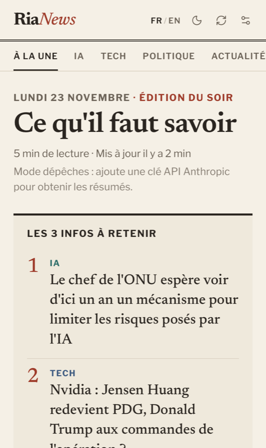
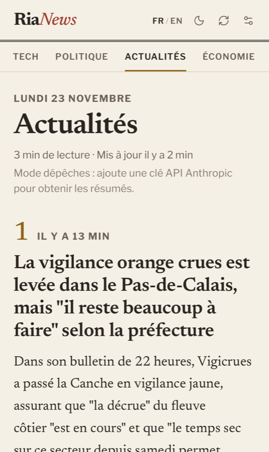
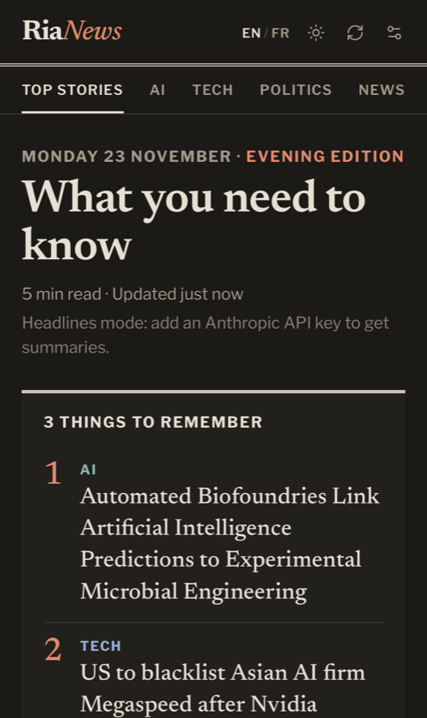
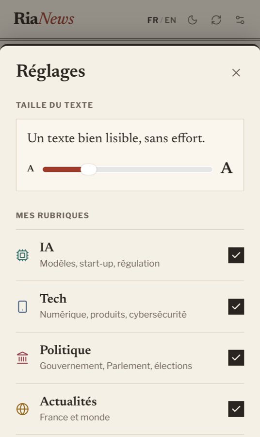
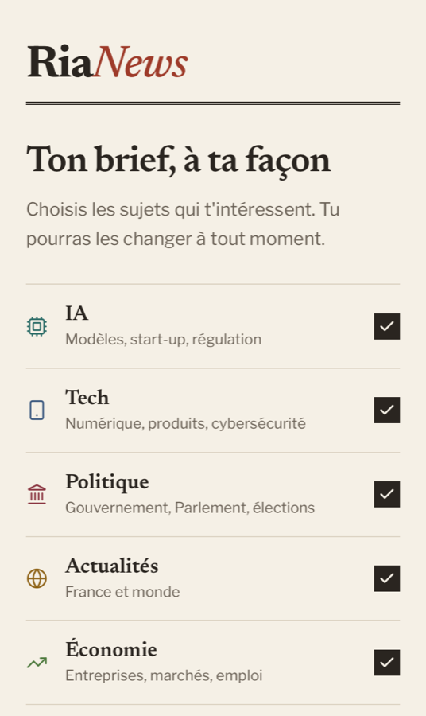
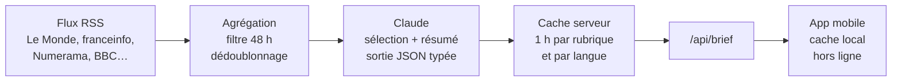

<div align="center">


# RiaNews

**L'actu qui compte, en deux minutes.**

Une app mobile installable (iPhone et Android) qui résume chaque jour l'essentiel de l'actualité par centre d'intérêt : IA, tech, politique, actualités, économie. Format court, grands caractères, pensé pour être lu d'une main.

[](https://nextjs.org)
[](https://www.typescriptlang.org)
[](https://tailwindcss.com)
[](https://docs.claude.com)
[](https://web.dev/progressive-web-apps/)
[](https://rianews.vercel.app)
[](./LICENSE)

[**Ouvrir l'app**](https://rianews.vercel.app) · [Read in English](./README.en.md)

</div>

---

## Pourquoi RiaNews ?

On veut être au courant de ce qui se passe, pouvoir en parler à table ou à la machine à café, sans passer une heure à faire défiler des fils d'actualité. RiaNews lit pour toi une vingtaine de médias, retient les sujets qui comptent vraiment et les résume en quelques lignes :

- **ce qui s'est passé**, en deux phrases, avec les chiffres et les noms clés ;
- **pourquoi ça compte**, en une phrase ;
- **une phrase à placer en société** : un chiffre frappant, une mise en perspective, un contexte peu connu.

Deux minutes de lecture le matin, et tu sais l'essentiel.

## Aperçu

<div align="center">

| Accueil | Rubrique | Mode sombre (EN) | Réglages | Premier lancement |
| :---: | :---: | :---: | :---: | :---: |
|  |  |  |  |  |

</div>

## Fonctionnalités

| | |
| --- | --- |
| **Brief par rubrique** | Les 6 sujets les plus importants des dernières 48 heures, dédoublonnés entre médias et classés par importance. |
| **Format court** | Titre clair, l'essentiel en 2 phrases, « Pourquoi ça compte », « À placer en société ». |
| **Les 3 infos à retenir** | En tête de l'accueil, le sujet principal de tes trois premières rubriques. |
| **Rubriques au choix** | IA, Tech, Politique, Actualités, Économie : sélection au premier lancement, modifiable à tout moment. |
| **Confort de lecture** | 5 tailles de texte (18 à 27 px, agrandies sur PC), typographie serif Newsreader, thème clair, sombre ou automatique, avec un bouton soleil/lune dans l'en-tête. |
| **Installable** | PWA : icône sur l'écran d'accueil, plein écran, aucune boutique d'applications nécessaire. |
| **Hors ligne** | Le dernier brief reste lisible sans réseau (service worker + `localStorage`). |
| **Pensée pour le pouce** | Onglets en haut, glisser à gauche ou à droite pour changer de rubrique, partage natif d'une info. |
| **Bilingue** | Interface et résumés en français ou en anglais, bascule FR/EN en un geste depuis l'en-tête, sources adaptées à chaque langue. |
| **Sans compte, sans pistage** | Aucune inscription, aucun cookie publicitaire : les préférences restent sur ton téléphone. |

## Comment ça marche



1. **Agrégation** : pour chaque rubrique, l'app lit 3 à 5 flux RSS publics, garde les articles des dernières 48 heures et supprime les doublons.
2. **Résumé** : Claude reçoit jusqu'à 45 dépêches, choisit les 6 sujets les plus marquants, regroupe les articles qui parlent du même sujet et rédige le format court. La réponse est une sortie structurée validée par un schéma Zod, et chaque sujet garde le lien vers ses sources.
3. **Cache** : chaque brief est mis en cache une heure par rubrique et par langue. Au maximum 10 appels à l'API par heure, quel que soit le nombre de lecteurs.
4. **Lecture** : l'app affiche immédiatement le dernier brief enregistré sur le téléphone, puis le remplace par la version fraîche.

Sans clé API, l'app fonctionne en **mode dépêches** : elle affiche les derniers titres avec leur chapô, sans résumé.

## Stack technique

| Couche | Choix |
| --- | --- |
| Framework | [Next.js 16](https://nextjs.org) (App Router, Turbopack), React 19 |
| Langage | TypeScript (strict) |
| Style | Tailwind CSS v4, polices Newsreader (texte) et Libre Franklin (titres de rubrique) via `next/font` |
| IA | [Claude API](https://docs.claude.com) via `@anthropic-ai/sdk`, sorties structurées + Zod, repli serveur en cas de refus |
| Données | `rss-parser`, cache `unstable_cache` de Next.js |
| i18n | `next-intl` (`/fr`, `/en`) |
| PWA | manifest Next.js, icônes générées avec `next/og`, service worker maison |
| Stockage client | `localStorage` via `useSyncExternalStore` (préférences + derniers briefs) |
| Hébergement | Vercel, déploiement continu depuis `main` |

## Sources

| Rubrique | Français | Anglais |
| --- | --- | --- |
| IA | ActuIA, Le Monde Pixels, The Verge, Google Actualités | The Verge, MIT Technology Review, Google News |
| Tech | Numerama, Frandroid, 01net, franceinfo, Google Actualités | BBC, Ars Technica, The Verge, Google News |
| Politique | Le Monde, franceinfo, Le Figaro, Google Actualités | BBC, Google News |
| Actualités | Le Monde, franceinfo, Libération, Google Actualités | BBC, BBC World, Google News |
| Économie | Le Monde, franceinfo, Le Figaro, Google Actualités | BBC, Google News |

Uniquement des flux RSS publics. La liste se modifie dans [`src/data/categories.ts`](./src/data/categories.ts).

## Démarrage rapide

**Prérequis** : Node.js 20 ou plus, npm.

```bash
git clone https://github.com/riadh-mnasri/rianews.git
cd rianews
npm install
cp .env.example .env.local   # puis renseigner ANTHROPIC_API_KEY
npm run dev
```

L'app tourne sur [http://localhost:3185](http://localhost:3185).

### Variables d'environnement

| Variable | Obligatoire | Description |
| --- | :---: | --- |
| `ANTHROPIC_API_KEY` | Non | Active les résumés rédigés par Claude. Sans clé : mode dépêches. |
| `ANTHROPIC_BRIEF_MODEL` | Non | Modèle utilisé pour les résumés. Par défaut `claude-opus-5-5`. `claude-haiku-5-5` pour réduire le coût. |

### Scripts

| Commande | Rôle |
| --- | --- |
| `npm run dev` | Serveur de développement sur le port 3185 |
| `npm run build` | Build de production |
| `npm run start` | Sert le build de production |
| `npm run lint` | ESLint |

## Installer l'app sur son téléphone

| iPhone (Safari) | Android (Chrome) |
| --- | --- |
| 1. Ouvrir [rianews.vercel.app](https://rianews.vercel.app)<br/>2. Toucher le bouton **Partager**<br/>3. Choisir **Sur l'écran d'accueil** | 1. Ouvrir [rianews.vercel.app](https://rianews.vercel.app)<br/>2. Toucher **Installer** dans la bannière<br/>3. Ou menu ⋮ puis **Installer l'application** |

## Déploiement

Le projet est déployé sur Vercel avec l'intégration GitHub : chaque push sur `main` part en production.

```bash
vercel env add ANTHROPIC_API_KEY production
vercel deploy --prod
```

## Structure du projet

```
src/
├── app/
│   ├── [locale]/          # page et layout localisés (fr, en)
│   ├── api/brief/         # GET /api/brief?cat=ia&locale=fr
│   ├── icons/[size]/      # icônes PWA générées (192, 512, maskable)
│   └── manifest.ts        # manifest de l'app installable
├── components/            # AppShell, StoryCard, réglages, onboarding, bannière d'installation
├── data/                  # rubriques et flux RSS
├── i18n/                  # configuration next-intl
└── lib/
    ├── rss.ts             # agrégation, filtre 48 h, dédoublonnage
    ├── brief.ts           # prompt et appel Claude, sortie structurée
    ├── cached.ts          # cache serveur 1 h
    ├── brief-store.ts     # cache local des briefs (hors ligne)
    └── prefs-store.ts     # préférences (rubriques, taille, thème)
messages/                  # traductions fr / en
public/sw.js               # service worker
```

## Choix de conception

- **Lisibilité d'abord** : mise en page de journal (double filet, filets fins, petites capitales) plutôt que des cartes arrondies. Papier crème et encre brun-noir, jamais de noir pur sur blanc pur ; mode sombre chaud sans noir absolu. Texte de 20 px par défaut sur mobile, environ 24 px sur grand écran, largeur de ligne limitée.
- **Pas de base de données** : un lecteur, un téléphone. Les préférences et le dernier brief vivent en `localStorage`, le serveur ne garde qu'un cache.
- **Coût maîtrisé** : un appel Claude par rubrique et par langue au plus toutes les heures, et seulement si quelqu'un ouvre l'app.
- **Fidélité aux sources** : le prompt interdit d'inventer, chaque sujet renvoie vers les articles d'origine.

## Feuille de route

- [x] Briefs par rubrique résumés par Claude
- [x] PWA installable, lecture hors ligne
- [x] 5 tailles de texte, thème sombre, FR / EN
- [ ] Notification du brief du matin
- [ ] Rubriques personnalisées (mots-clés libres)
- [ ] Marquer les infos déjà lues
- [ ] Version audio du brief

## Avertissement

Les résumés sont générés automatiquement à partir des flux des médias cités. Vérifie la source avant de citer un chiffre. Les articles restent la propriété de leurs éditeurs.

## Licence

Distribué sous licence MIT. Voir [LICENSE](./LICENSE).

© 2026 Riadh MNASRI
